# UFlix

A lightweight desktop media player and library for **Windows and Linux**. Play local files, torrents (streamed while they
download), YouTube, IPTV and web streams, and browse movies and shows through TMDB, all in one native app with no
embedded web browser.

UFlix is written in **Rust** with a [Slint](https://slint.dev/) interface and plays everything with
[mpv](https://mpv.io/). mpv draws the video straight into the app's OpenGL frame with zero-copy hardware decoding, and
the controls are drawn on top of it in the same frame, so overlays stay translucent and cheap.

> **Status:** in active development. Linux (Wayland and X11, Ubuntu 24.04+ or equivalent) and Windows 10/11.

## Screenshots

| Home | Search, with Movies and Shows tabs |
|---|---|
| 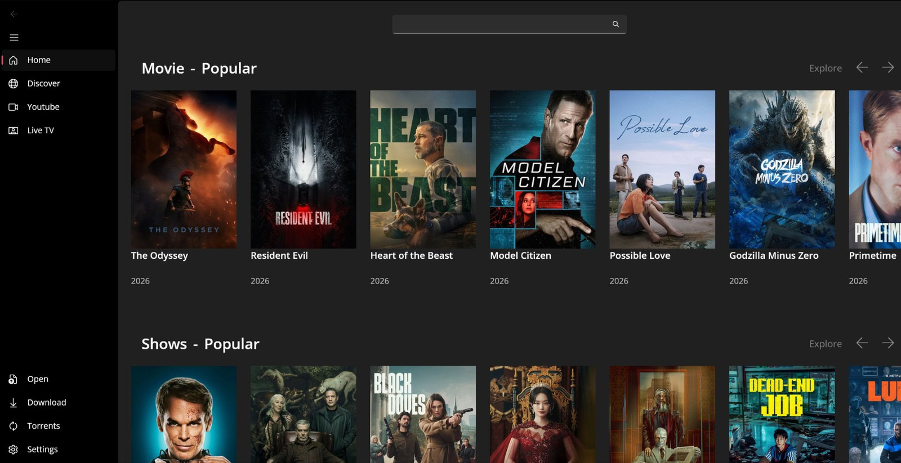 | 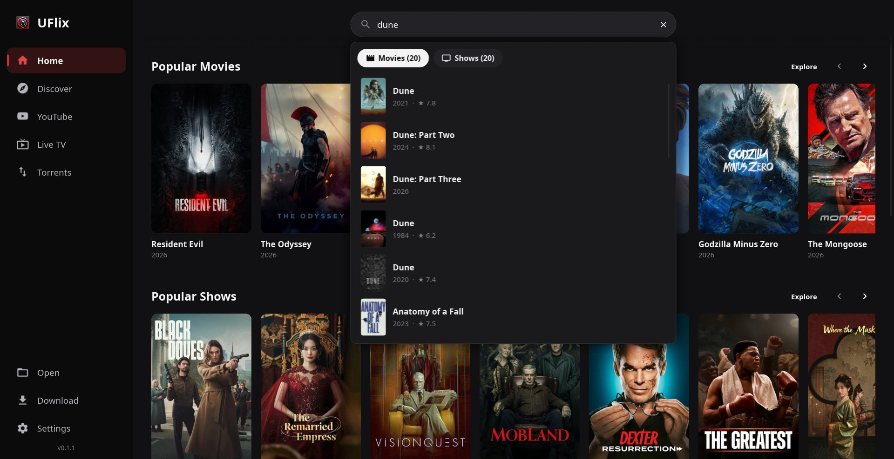 |
| **Discover: movies** | **Discover: shows** |
| 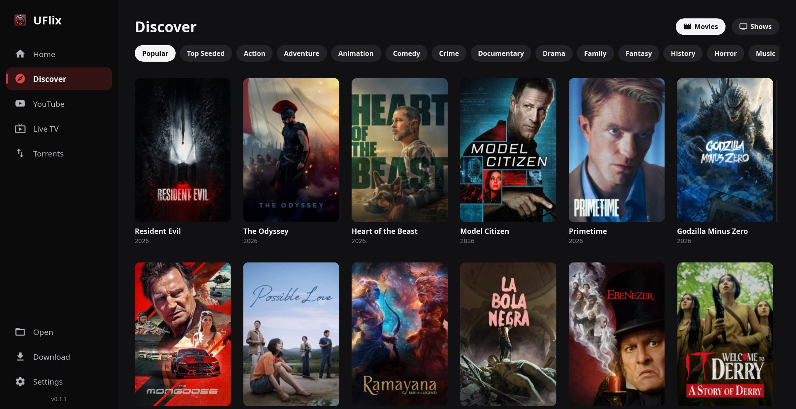 | 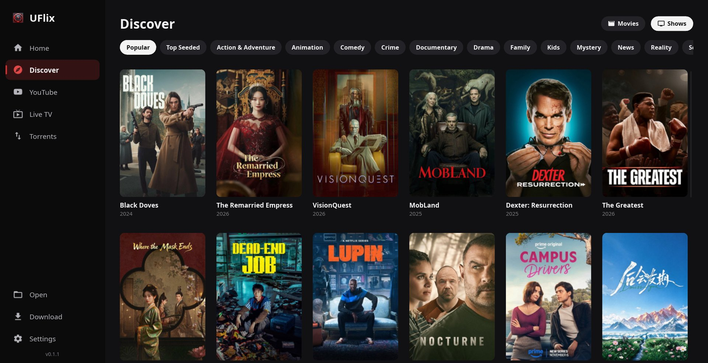 |
| **A movie: details, cast and sources by quality** | **A show: seasons, episodes and sources** |
| 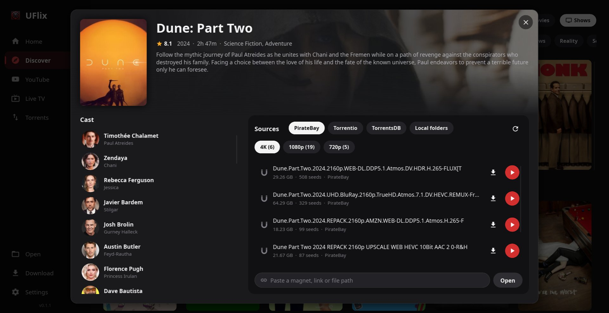 | 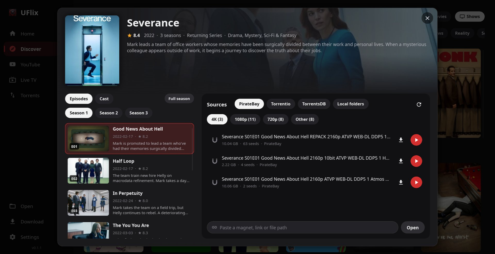 |
| **YouTube** | **A YouTube channel** |
| 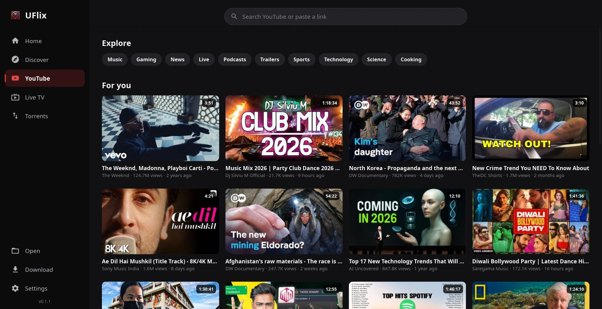 | 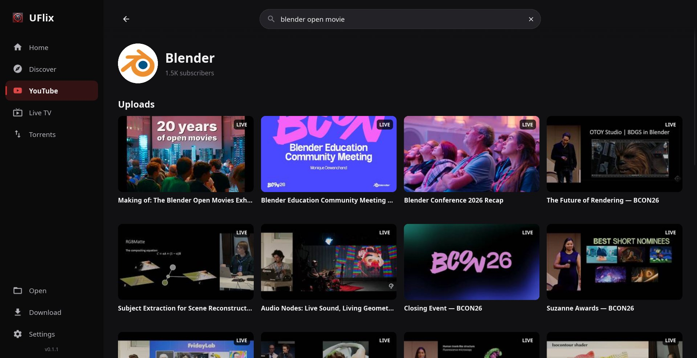 |
| **Torrents: search and downloads** | **Settings** |
| 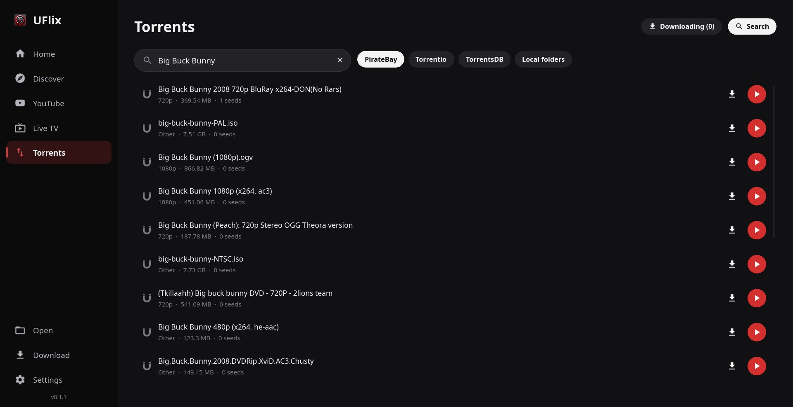 | 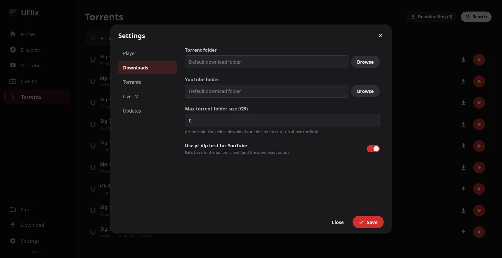 |
| **Advanced controls: speed and picture** | **Info panel** |
| 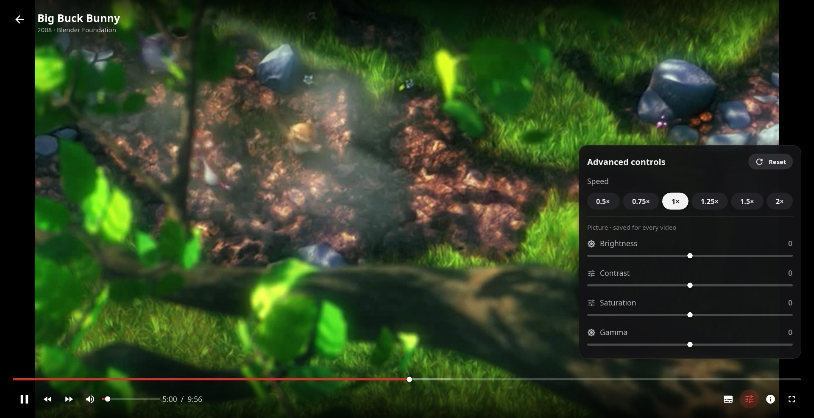 | 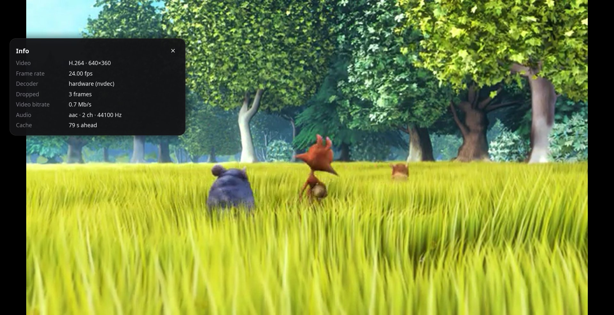 |

**YouTube in the player, with details and Up next**

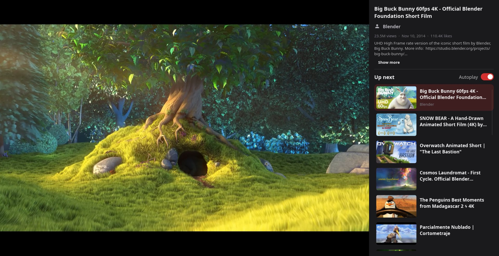

*Player screenshots: [Big Buck Bunny](https://peach.blender.org/) © 2008 Blender
Foundation, [CC BY 3.0](https://creativecommons.org/licenses/by/3.0/), streamed from the
[Internet Archive](https://archive.org/details/BigBuckBunny_124) and YouTube.*

## Download

Get the latest version from [Releases](../../releases/latest):

- **Windows:** `UFlix-win-Setup.exe` installs per user, with no admin rights needed.
- **Linux:** `UFlix-x86_64.AppImage`. Make it executable (`chmod +x UFlix-x86_64.AppImage`) and run it.

Both update themselves: UFlix checks for a new version once a day, or when you use **Settings → Updates → Check now**.
Downloads are checked against the release's `SHA256SUMS`.

## Features

- **Local files:** subtitles next to the video or in `Subs/` are picked up; "Continue watching" shows a frame of the video
- **Torrents:** magnet links and `.torrent` files play while they download (pure-Rust engine, librqbit); multi-file
  torrents list their files in the player; whole torrents can be downloaded and seeded
- **YouTube:** home feed, search with filters, channels, playlists, Up next with autoplay, quality and caption menus,
  downloads through yt-dlp
- **IPTV and web streams** from M3U playlists or any link
- **Discover:** movies and shows from TMDB by popularity, seeds or genre, with cast, seasons and episodes
- **Subtitles:** online search (OpenSubtitles, SubDL), delay, font, size and colour
- **Advanced controls:** playback speed, plus brightness, contrast, saturation and gamma for dark films (saved, one-click
  reset)
- **Low resource use:** zero-copy hardware decoding (NVDEC on NVIDIA, VA-API on Intel/AMD, D3D11 on Windows), no web
  engine, nothing ticking while the app is idle

Keyboard in the player: Space play/pause · ←/→ ±10 s · ↑/↓ volume · M mute · F fullscreen · T side panel · I info ·
Z/X subtitle delay · N next · Esc back.

## Building

Requirements: Rust (stable) and, on Linux, `libfontconfig1-dev` and `libxkbcommon-dev`.

```bash
git clone <repo-url> && cd UFlix
Native/natives.sh fetch            # the bundled libmpv (once per clone)
cp secrets.env.example secrets.env # API keys: TMDB, OpenSubtitles, SubDL (optional, compiled in)
cargo run --release                # or: cargo run --release -- /path/to/video.mkv
```

### Packages

```bash
packaging/linux/package.sh                       # → out/linux/UFlix-x86_64.AppImage
packaging\windows\package.ps1 -Version 1.0.0     # → out\windows\UFlix-win-Setup.exe (Inno Setup 6)
```

Releases are built by CI: bump `VERSION` on master and `.github/workflows/release.yml` builds both OSes and publishes
`vX.Y.Z` with the installers and `SHA256SUMS`.

### Native library

libmpv is the only native library and is never taken from the system. It isn't in git: it is mirrored as the assets of
a `natives-N` prerelease pinned by `Native/natives.lock`; `Native/natives.sh fetch` downloads and checks it. The
**Natives** workflow rebuilds the set: the Linux libmpv from source (mpv 0.41 + FFmpeg 7.1 with NVDEC and VA-API
zero-copy for the OpenGL render API, see [Native/readme.md](Native/readme.md)) and the newest Windows LGPL build.

### Tests

```bash
cargo test                 # parsers and other unit tests
cargo clippy --all-targets # lints
```

`UFLIX_TOUR=<folder>` makes the app walk all its screens and save screenshots (this README's images come from it; use a
scratch `XDG_DATA_HOME`).

## Project layout

```
app/                the UFlix app: Slint UI (ui/), page and dialog controllers, the player, services
crates/
  engine/           UI-free core: SQLite store, settings, TMDB, catalogues, torrent and subtitle search, YouTube, IPTV
  mpv/              libmpv binding: player, OpenGL render context, stream callbacks
  torrent/          torrent engine on librqbit with a blocking, cancellable stream for the player
Native/mpv/         scripts that produce the bundled libmpv
packaging/          AppImage and Windows installer scripts
```

How it fits together: [doc/Development.md](doc/Development.md).

## License

UFlix is free software: you can redistribute it and/or modify it under the terms of the **GNU General Public License,
version 3 or (at your option) any later version**. See [LICENSE](LICENSE).

Bundled and linked third-party components keep their own licences:

| Component | Licence |
|---|---|
| mpv / libmpv, Linux build | GPL-2.0-or-later |
| mpv / libmpv, Windows build | LGPL-2.1-or-later |
| FFmpeg, bundled on Linux | LGPL-3.0-or-later |
| Slint | GPL-3.0 (used under GPLv3) |
| librqbit | Apache-2.0 |
| rustypipe | GPL-3.0 |
| other crates (tokio, reqwest, rusqlite, serde, …) | their respective licences (MIT / Apache-2.0 and similar) |

The source for each bundled native binary is identified in the `BUILDINFO.txt` next to it.

## Disclaimer

UFlix is a player. It does not host, index or provide any content. You are responsible for making sure that what you
stream or download is legal where you live.
